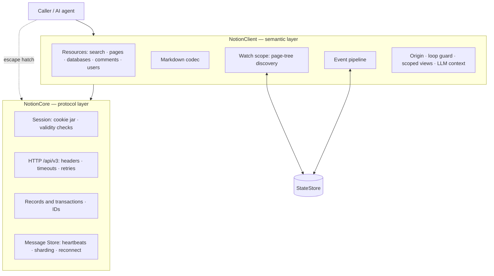
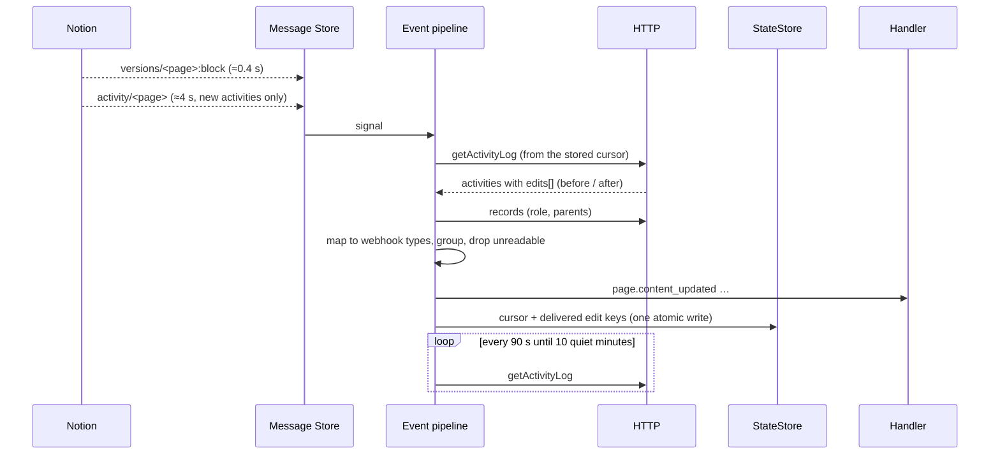

# Architecture

How Gabriel Notion is built and why. For contributors and for anyone porting the SDK to another
language; the normative rules are in [`spec/behavior.md`](../spec/behavior.md), and the API in the
[Node.js SDK README](../sdks/node/README.md).

## 1. Goals and non-goals

Goals:

* Act as one person, through their Notion web session, with the capabilities of Notion's official
  REST API and MCP server: search, pages as Markdown, databases, comments, members.
* Deliver change events with the official webhook type names for **everything the person can read
  in a workspace**, in the caller's process — no integration to install, no pages to share with a
  bot, no public HTTPS endpoint.
* Be safe to hand to an AI agent: its own writes do not echo back, loops are cut off, access can be
  narrowed, and untrusted content is marked as such.
* Stay honest about gaps: what was not delivered is reported, and protocol changes surface as
  events instead of silent failures.

Non-goals (v0.1): official-API request compatibility, file uploads, sharing one watcher between
processes, more than one workspace per client.

## 2. Two layers

* **Core** makes no requests of its own beyond what callers ask for (plus one session check after
  a 401) and returns server responses unmodified. New protocol capabilities are reachable through
  it before the client wraps them.
* **Client** is built only on Core and may be opinionated. It exposes Core as `client.core`; scoped
  views do not.

## 3. Credentials and session

The only credential is the browser session's cookie set. It stays in memory; `Set-Cookie` answers
are applied (Notion may rotate `token_v2`), and an optional `CredentialStore` receives a snapshot
whenever a session cookie changes. Cookie values never appear in errors, logs, events or
`health()`, and are sent only to `https` / `wss` Notion hosts.

Validity is checked, not guessed: a 401, or a read that returns 200 without its record, triggers
one `authValidate` call (concurrent triggers share it). Only a 401 there moves the session to the
terminal `AUTH_DEAD` state. The SDK never signs in again on its own.

Ways to obtain a session — an interactive window with a throw-away profile, the DevTools port of a
running Chrome, or Chrome's cookie store on macOS — all hand the cookies over in-process and verify
them before returning.

## 4. HTTP

Every call is `POST /api/v3/<endpoint>` with the active-user and workspace headers. Retries use
full-jitter exponential backoff, split by safety: read endpoints are retried on 429, 5xx and network
errors; anything else is treated as a write and retried only on 429, because replaying a
transaction is not proven safe. Status codes map to the error codes in spec §12.

## 5. Records, transactions and IDs

Reads go through `syncRecordValues` in batches of 1,000 pointers. Each record carries a `role`;
`none` means "does not exist or cannot be read" — Notion does not distinguish, so neither does the
SDK (`NOT_FOUND`).

Writes are transactions of operations (`set`, `update`, `listAfter`, text operations…), applied
atomically. Because the server sometimes answers 200 without applying a change, **every write
method reads its records back** and fails with `WRITE_NOT_APPLIED` when they do not show it. New
block IDs follow the web client's UUID v8 layout (creation day and the workspace's short ID); other
records use UUID v4.

## 6. Markdown

Bodies are read and written as Notion-flavored Markdown, the format of Notion's official tools.
The renderer reproduces their output byte for byte on the shared fixtures in
[`spec/fixtures/markdown`](../spec/fixtures/markdown); the parser accepts that format and plain
Markdown. Blocks named in the Markdown by ID (child pages, databases, synced blocks, discussion
anchors) are kept when content is rewritten, so edits do not detach comments.

## 7. The Message Store connection

Notion's realtime service (Engine.IO v4 with Primus framing over WebSocket) carries only signals —
"this key changed, here is its new counter or version" — never content.

* **Heartbeats.** Both layers must be answered: Engine.IO `2` → `3`, and Primus
  `primus::ping::<t>` → `primus::pong::<t>`; without the second, the server closes the connection
  after about 35 s.
* **Keys.** Per page `versions/<id>:block` (record changed) and `activity/<id>` (a new activity);
  per data source `collection/<id>` (rows changed). There is no workspace-wide key, which is why
  the SDK watches a page tree (section 9).
* **Sharding.** A connection holds about 50,000 keys; the SDK puts at most 40,000 on each and opens
  more as needed. A batch past the limit is rejected as a whole without explanation, so a rejected
  batch moves to a new connection.
* **Initial state.** Subscribing with version `-1` makes the server reply with each key's current
  state. Those frames are marked `initial` and not treated as changes — otherwise a cold start over
  tens of thousands of keys becomes as many reads.
* **Permissions.** Subscriptions are not authenticated or filtered: anyone can subscribe to any
  page ID. Content always comes from authenticated HTTP reads, and events for unreadable records
  are dropped.

## 8. The event pipeline

* **Content from the activity log.** A signal only says *what* changed. The page's or data
  source's activity log says how: activity types (`block-edited`, `page-locked`, `commented`,
  `collection-row-created`, …) with `edits[]` that carry the records before and after. Spec §8.2
  maps them to webhook events.
* **Windows.** Notion merges continuous editing into one activity and stops sending `activity/`
  signals while it merges; page signals are throttled to about one a minute. So a signal opens a
  window: the entity is read 1 s after an `activity/` signal (5 s after a record signal, because the
  log lags the record by about 4 s), then every 90 s until 10 minutes pass without change. Merged
  edits are caught by the re-reads; nothing needs a per-block subscription.
* **De-duplication.** Each edit has a key (activity, edit type, target, timestamp). Delivered keys
  are stored with the cursor in one atomic write, so re-reading a merging activity yields only the
  new edits, and a crash neither skips nor repeats events. Event IDs are hashes of their edit keys,
  so they are stable across runs and languages.
* **Lazy baseline.** A newly watched entity gets an empty cursor stamped with the current time; its
  first read treats older edits as history. No read is needed up front, which matters when a cold
  start subscribes tens of thousands of pages.
* **Changes without activity.** Comment edits, view edits and property renames open no activity;
  they are found by comparing two versions of the record a `versions/` signal announced.
* **Drift.** Unknown activity types, edit types or frames produce `guard.protocol_drift` once per
  kind and no event.

## 9. Watch scope and discovery

The SDK walks the page tree from its roots — the workspace root (`space.pages`), the private section
(`space_view.private_pages`), readable teamspaces (`team_pages`), pages shared with the person — or
from explicit roots, through non-page blocks (columns, toggles, synced blocks) to find nested pages.
Every page and database is watched as a page, every data source as a data source; rows come through
their data source.

New content is followed from signals: a watched page's `versions/` key (its children changed), the
teamspace, private-section and workspace-root records, the shared-pages list, and the teamspace
list. Pages that appear at those roots have no parent activity, so discovery reports them itself.
The tree is stored; later starts subscribe to it at once and re-walk in the background, and a
periodic re-walk (default 6 h) reconciles anything missed.

A workspace with about 30,000 readable pages and 8,500 data sources needs about 87,000 keys on 3
connections, and its first walk reads about a million blocks in roughly 6 minutes. The walk keeps
full records only for pages and databases and reads in parallel batches.

## 10. Recovery

Re-reading every watched entity after a reconnect would cost tens of thousands of requests. Instead,
the SDK resubscribes with the versions it last saw; the server then sends one frame for each key
that changed meanwhile, and only those entities (plus any with an open window) are read back with
`delivery: "backfill"`. A restart takes the same path, starting from the last stored "alive" time.

Live events produced during a recovery are held until it ends, so backfilled events always come
first, and every recovery ends with `connection.gap` stating what was read back and what could not
be.

## 11. Acting as a person safely

* **Origin.** Every transaction registers its records before it is sent; read-backs register the
  versions they confirmed. An edit by the person is `this_client` when its version is one the SDK
  wrote — or, for edits without versions (lock, trash), when it matches an SDK write of the same
  kind and direction within ±30 s, each write claimed once. The SDK's edits and the person's other
  edits never share an event. `this_client` events are not delivered by default.
* **Loop guard.** Handlers run inside an async context; writes from it are counted per target page
  (5 per minute by default) and refused beyond that, before anything is sent.
* **Scoped views.** `scope(policy)` returns the same API limited to page subtrees and teamspaces
  (checked by walking up the parent chain), optionally read-only, action-limited or approval-gated,
  and without `core`.
* **LLM context.** `toLLMContext()` separates metadata from content and wraps content in an
  envelope marked untrusted that the content cannot open or close.

## 12. Extension points

| Point | Interface | Default |
| --- | --- | --- |
| State | `StateStore` (`get`, `set`, `delete`, `batch`, `keys`, `flush`, `close`, `health`); `batch` must be atomic | `FileStateStore` |
| Credentials | `CredentialStore` (`load`, `save`) | none (memory only) |
| HTTP | `fetch` | global `fetch` |
| Realtime | `webSocketFactory(url, { headers })` | Node's `WebSocket` |
| Logging | pino-style logger | silent |

Unit tests use these to run without a network: a scripted `fetch` and an in-memory Message Store
that replays like the real one.

## 13. Multi-language parity

`spec/` is the contract: [`behavior.md`](../spec/behavior.md) for the rules,
[`schema/`](../spec/schema) for every event, and [`fixtures/`](../spec/fixtures) for Markdown
(records → exact output) and events (recorded activities → exact events, IDs included). A port is
complete when it passes the shared fixtures and follows the spec; the Node.js SDK is the reference.

## 14. Roadmap

* A Python SDK built from the spec.
* Per-block subscriptions for callers who need second-level latency on a few pages.
* File uploads.
* A local daemon so several processes can share one account's events.
